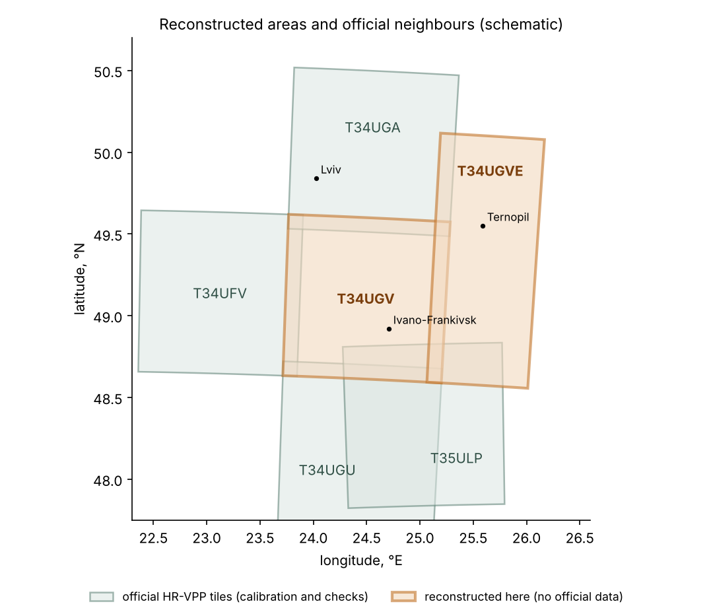
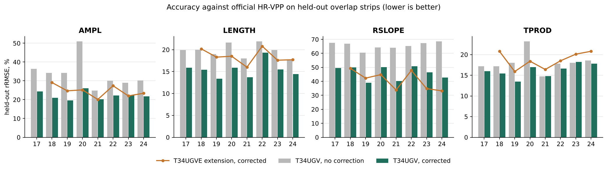

# hrvpp-tile-recovery

Reconstruction of missing Copernicus HR-VPP season-1 phenology parameters from Sentinel-2 for tile T34UGV and
the area east of it (western Ukraine, 2017–2024), with a correction to the official product and validation
against official tiles.

## 1. Background

The Copernicus Land Monitoring Service (CLMS) distributes the High Resolution Vegetation Phenology and
Productivity (HR-VPP) parameters at 10 m resolution for Europe. They are derived from Sentinel-2 time series of the
Plant Phenology Index (PPI). The MONIFUN project (work package 3) uses four season-1 parameters as covariates at
National Forest Inventory plots:

| parameter | meaning | unit |
|---|---|---|
| `AMPL` | seasonal amplitude: difference between the peak and the base level of PPI | PPI |
| `LENGTH` | season length: time between start and end of season | days |
| `RSLOPE` | right slope: rate of PPI decrease at the end of the season | PPI day⁻¹ |
| `TPROD` | total productivity: integral of PPI over the season | PPI × days |

The Sentinel-2 tile T34UGV (Ivano-Frankivsk and Lviv regions) is missing from HR-VPP for every year 2017–2025. The
catalogue and the map service both confirm that this is a production gap, not a download error. East of T34UGV
(Ternopil region and further east) there is no official product at all. Plots in these areas therefore have no
HR-VPP values.

This repository contains the code that recomputes the four parameters for these areas, corrects them towards the
official product and checks their accuracy. The output files follow the layout and encoding of the official
files, so the MONIFUN extraction scripts read them without modification.

## 2. Study areas

<p align="center"></p>
<p align="center"><em>Figure 1. Reconstructed areas and the official HR-VPP tiles used for correction and validation.</em></p>

| area | grid (EPSG:32634, 10 m) | years | official tiles in the overlap |
|---|---|---|---|
| T34UGV | 10 980 × 10 980 px, upper-left x 699 960, y 5 500 020 | 2017–2024 | T34UFV, T34UGA, T34UGU, T35ULP |
| T34UGVE (east extension, working name) | 7 000 × 16 980 px, upper-left x 799 760, y 5 560 020; ≈ 25.1–26.1° E, 48.6–50.2° N | 2017–2024 | T34UGA, T35ULP |

Each area overlaps official tiles by about 10 km. The extension overlaps T34UGV by 10 km, which allows the joint to
be checked. The year 2025 is not produced because official HR-VPP 2025 data are not yet available for correction
and validation.

## 3. Data

* Sentinel-2 Level-2A surface reflectance; Level-1C only where no Level-2A scene exists (mainly 2017–2018).
  Source: Google Earth Engine (`COPERNICUS/S2_SR_HARMONIZED`) or Microsoft Planetary Computer.
* Cloud Score+ (Earth Engine only) and the Sentinel-2 scene classification layer (SCL) for cloud masking.
* Official HR-VPP VPP files, version V101, of the neighbouring tiles, downloaded through the WEkEO Harmonised Data
  Access (HDA) API (dataset `EO:EEA:DAT:CLMS_HRVPP_VPP`).

## 4. Method

### 4.1 Reconstruction

The reconstruction follows the HR-VPP Algorithm Theoretical Basis Document (ATBD) and the Product User Manual
wherever they specify the processing, and uses documented simplifications elsewhere:

1. PPI is computed for every clear Sentinel-2 observation with the ATBD formula (Jin and Eklundh, 2014).
2. Observations are aggregated into 10-day median composites from 1 October of the previous year to 31 March of
   the following year.
3. Winter bins without observations receive the base level; remaining gaps up to 60 days are filled by linear
   interpolation, and the series is smoothed with two passes of a 1-2-1 filter.
4. Start and end of season are set where PPI crosses 25 % and 15 % of the seasonal amplitude; AMPL, LENGTH,
   RSLOPE and TPROD are derived from the series between these dates.

The operational chain fits a double-logistic function with TIMESAT instead of steps 2–3. The reconstructed values
therefore differ systematically from the official product, which is addressed by the correction in 4.2. All
differences from the operational chain are listed in [`docs/METHOD.md`](docs/METHOD.md).

### 4.2 Correction

For each year and parameter a regression model is trained on the pixels where the reconstruction overlaps official
tiles. Predictors are the reconstructed parameters, the start and end of season and the number of clear
observations; the target is the official value. The model is gradient boosting (scikit-learn
`HistGradientBoostingRegressor`, 40 trees with 15 leaves), followed by quantile mapping of its output onto the
official distribution so that the corrected values keep the variance of the official product. The model is then
applied to the whole area. Alternative methods (no correction, linear calibration, quantile mapping alone, gradient
boosting alone) were compared before this choice; see [`docs/VALIDATION.md`](docs/VALIDATION.md).

### 4.3 Output encoding

Data type, scale factor, nodata value, band description, unit and the `PhysRange` tag are copied from the official
file of the same parameter. Band descriptions follow the official pattern, e.g. `Seasonal amplitude 2018-season1`.

## 5. Validation

Accuracy is assessed by leave-one-strip-out cross-validation. For T34UGV the correction model is trained on three of
the four overlap strips and tested on the fourth, which plays the role of the gap; this is repeated for each strip and
the results are averaged. For T34UGVE, with two strips, the model is trained on one and tested on the other. Each
strip contributes 200 000 random pixels per year. The metrics are Pearson's r, relative root-mean-square error
(rRMSE, % of the official mean), bias and the ratio of standard deviations.

Relative RMSE on the held-out strips, range over the years (%):

| area | correction | AMPL | LENGTH | RSLOPE | TPROD |
|---|---|---|---|---|---|
| T34UGV, 2017–2024 | none | 25–51 | 18–22 | 61–69 | 15–23 |
| T34UGV, 2017–2024 | applied | 20–26 | 13–19 | 39–51 | 14–18 |
| T34UGVE, 2018–2024 | none | 27–45 | 20–29 | 58–63 | 18–26 |
| T34UGVE, 2018–2024 | applied | 20–29 | 16–21 | 33–49 | 16–21 |

<p align="center"></p>
<p align="center"><em>Figure 2. Relative RMSE on held-out overlap strips by parameter and year.</em></p>

Main findings:

* After correction the standard deviation of the reconstructed values is 0.95–1.05 of the official one for T34UGV
  (0.58–1.16 before), so the reconstructed tile has the same spatial variability as its neighbours.
* In the 10 km overlap of T34UGVE and T34UGV the two reconstructions agree with r = 0.96–0.99 for all parameters.
  The season in T34UGVE is 5–8 days longer than in T34UGV.
* Two independent implementations, Earth Engine and a GPU implementation on Planetary Computer data, give
  r = 0.81–0.99 for the uncorrected parameters on the same pixels (tested for 2021 and 2024).
* RSLOPE is the least accurate parameter. The year 2020, with the fewest clear observations, is the least accurate
  year for all parameters.

Per-year tables, the method comparison and the sensitivity tests are in [`docs/VALIDATION.md`](docs/VALIDATION.md).

## 6. Output files

```
Copernicus_Phenology/<PRODUCT>/<YEAR>/VPP_<YEAR>_S2_<AREA>-010m_RECON_s1_<PRODUCT>.tif
```

`<AREA>` is `T34UGV` or `T34UGVE`; together 64 files (4 parameters × 2 areas × 8 years). The CRS, grid, data type,
scale, nodata value and band metadata match the official files, so `_run_extract_xbyx_*.R` in MONIFUN reads them
without changes.

The files are not official CLMS products. They are marked by `_RECON_` in the file name and by the GeoTIFF tags
`SOURCE` and `CALIBRATION`. When they are used, plots inside the reconstructed areas should be flagged so that
analyses can be repeated with and without the reconstructed values.

## 7. Reproduction

A step-by-step guide with run times and Earth Engine costs is in [`docs/REPRODUCE.md`](docs/REPRODUCE.md). All
input data are public. Credentials are supplied through environment variables (`.env.example`) and are not stored
in the repository.

```bash
git clone https://github.com/yevheniikhan/hrvpp-tile-recovery && cd hrvpp-tile-recovery
pip install -r requirements.txt               # requirements-local.txt in addition for the route without Earth Engine
cp .env.example .env                          # fill in locally; not tracked by git
pytest -q                                     # 21 tests on synthetic data, no accounts required

python scripts/check_gap.py --tile T34UGV --years 2017-2025                        # 1. confirm the gap
python scripts/download_official.py --years 2017-2024                              # 2. official neighbouring tiles
python scripts/ee_export.py --region T34UGV --years 2017-2024                      # 3a. reconstruction in Earth Engine
python scripts/local_reconstruct.py --region T34UGVE --years 2021                  # 3b. or on Planetary Computer
python scripts/mosaic_shards.py --in <exports> --out data/raw                      #     merge Earth Engine shards
python scripts/calibrate.py --raw-dir data/raw --region T34UGV --years 2017-2024   # 4. correction and output files
python scripts/compare.py raw A.tif B.tif --year 2021                              # 5. compare two runs
```

Alternative entry points:

| environment | entry point |
|---|---|
| Google Colab | [`notebooks/hrvpp_tile_recovery.ipynb`](notebooks/hrvpp_tile_recovery.ipynb) |
| Earth Engine Code Editor | [`gee/hrvpp_recon_patch.js`](gee/hrvpp_recon_patch.js) |
| no Earth Engine access | `scripts/local_reconstruct.py` (Planetary Computer, CPU or GPU) |

The same procedure applies to any other area on a 10 m UTM grid that overlaps at least one official tile
(see "Another area" in [`docs/REPRODUCE.md`](docs/REPRODUCE.md)).

## 8. Repository structure

```
src/hrvpp_recon/
  config.py          tiles, areas, encodings, algorithm parameters
  catalogue.py       catalogue query (VITO OpenSearch)
  wekeo.py           download of official tiles through WEkEO HDA, with file integrity check
  gee_recon.py       reconstruction in Google Earth Engine
  s2local.py         reconstruction without Earth Engine (Planetary Computer, NumPy/CuPy)
  phenology_np.py    NumPy reference implementation of the season metrics
  learn.py           correction models and leave-one-strip-out validation
  postprocess.py     writing files with the official encoding and metadata
  pipeline.py        shard mosaicking, correction and output, comparisons
  validate.py, fastval.py, eedrive.py
scripts/             command-line steps 1–5
gee/                 Earth Engine Code Editor script
notebooks/           Colab notebook; experiments/ contains the scripts used for the reported results
tests/               unit and end-to-end tests on synthetic rasters
docs/                method, validation, reproduction guide, runbook, download integrity
```

## 9. Download integrity

The MONIFUN download script considers a query complete when the number of files in the output folder equals the
number of search results. If a WEkEO transfer is interrupted, a partly written GeoTIFF remains and is counted as
complete. This occurred in 4 of 84 downloads during this work. `wekeo.py` therefore reads the last row of every
downloaded GeoTIFF and repeats the download of files that fail. The check and its application to existing
downloads are described in [`docs/DOWNLOAD_INTEGRITY.md`](docs/DOWNLOAD_INTEGRITY.md).

## 10. Limitations

* The temporal model is simpler than the TIMESAT double-logistic fit; season dates and RSLOPE are noisier than in
  the official product.
* The correction is trained in the overlap strips. Landscapes absent from the strips, such as high-mountain
  forest, are extrapolated.
* For 2017 and partly 2018, Level-1C reflectance is used where Level-2A is not available, which lowers PPI.
* Only season 1 is reconstructed.

## 11. Citation and licence

The code is released under the MIT licence. Please cite the repository ([`CITATION.cff`](CITATION.cff)) and the
HR-VPP product (Copernicus Land Monitoring Service, HR-VPP, © European Union). Sentinel-2 data: © Copernicus/ESA.

## References

* Jin H., Eklundh L. (2014). A physically based vegetation index for improved monitoring of plant phenology.
  *Remote Sensing of Environment* 152, 512–525.
* Pasquarella V. J., Brown C. F., Czerwinski W., Rucklidge W. J. (2023). Comprehensive quality assessment of
  optical satellite imagery using weakly supervised video learning. CVPR Workshops, 2125–2135.
* Tian F. et al. (2021). Calibrating vegetation phenology from Sentinel-2 using eddy covariance, PhenoCam, and
  PEP725 networks across Europe. *Remote Sensing of Environment* 260, 112456.
* CLMS. HR-VPP Algorithm Theoretical Basis Document and Product User Manual.
