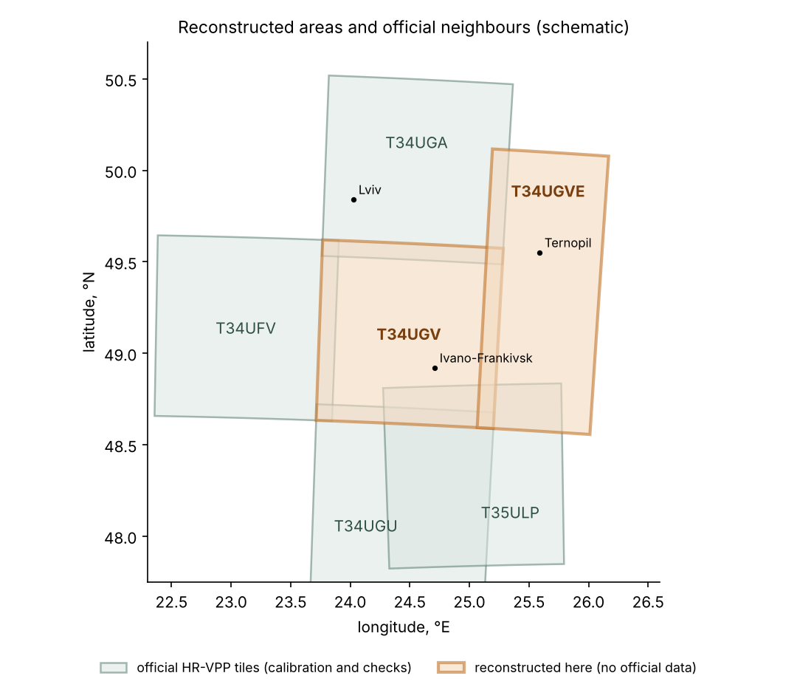
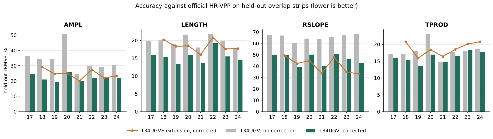

# hrvpp-tile-recovery

**Reconstruction of missing Copernicus HR-VPP vegetation phenology data from Sentinel-2, with a learned
correction to the official product and pixel-level validation.**

The Copernicus Land Monitoring Service publishes the HR-VPP (High Resolution Vegetation Phenology and
Productivity) parameters at 10 m for Europe. In western Ukraine one Sentinel-2 tile, **T34UGV**
(Ivano-Frankivsk, Kalush, Stryi), is missing for every year 2017–2025, and there is no official product at all
east of it (Ternopil region). The MONIFUN WP3 workflow, which extracts `AMPL`, `LENGTH`, `RSLOPE` and `TPROD`
(season 1) at National Forest Inventory plots, therefore has a hole there.

This repository fills the hole: it recomputes the season-1 parameters from Sentinel-2 with the HR-VPP
algorithm, learns a per-year correction on the pixels where the reconstruction overlaps official tiles, and
writes files that the MONIFUN scripts read like the official ones.

<p align="center"></p>

| area | grid (EPSG:32634, 10 m) | years | official tiles used for the correction |
|---|---|---|---|
| **T34UGV**, the missing tile | 10 980 × 10 980 px, UL 699 960 / 5 500 020 | 2017–2024 | T34UFV, T34UGA, T34UGU, T35ULP |
| **T34UGVE**, east extension | 7 000 × 16 980 px, UL 799 760 / 5 560 020 (≈ 25.1–26.1° E, 48.6–50.2° N) | 2017–2024 | T34UGA, T35ULP (2017: the T34UGV strips) |

2025 is not produced: there is no official HR-VPP 2025 yet to calibrate against.

## Results in one picture

<p align="center"></p>

Each bar is a **held-out** check: the correction is trained on some overlap strips and tested on another strip it
has never seen, against official HR-VPP pixels. Ranges over the years (relative RMSE, %):

| | AMPL | LENGTH | RSLOPE | TPROD |
|---|---|---|---|---|
| T34UGV, no correction | 25–51 | 18–22 | 61–69 | 15–23 |
| **T34UGV, corrected** | **20–26** | **13–19** | **39–51** | **14–18** |
| **T34UGVE, corrected** | **20–29** | **16–21** | **33–49** | **16–21** |

* The corrected values have the spread of the official product (T34UGV: standard deviation ratio 0.95–1.05).
* The extension joins T34UGV without a visible seam (10 km overlap: r 0.96–0.99 for all four products); the
  season in the extension is 5–8 days longer than in T34UGV.
* Two independent implementations agree: Earth Engine and a local GPU pipeline on Planetary Computer data give
  r 0.81–0.99 for the raw parameters on the same pixels (best in 2024, weakest for RSLOPE in 2021).
* RSLOPE stays the weakest product and 2020 the weakest year (fewest clear scenes). Details and all tables:
  [`docs/VALIDATION.md`](docs/VALIDATION.md).

> **The reconstructed files are not official CLMS products.** They carry `_RECON_` in the file name and
> `SOURCE`/`CALIBRATION` GeoTIFF tags. Report them as gap-filled and keep a flag for the affected plots.

## How it works

```
Sentinel-2 L2A (L1C where L2A is missing)
  → cloud mask (Cloud Score+ and SCL in Earth Engine; SCL only in the local route)
  → Plant Phenology Index, HR-VPP ATBD formula
  → 10-day median composites → winter base level → linear gap filling (≤ 60 days) → 1-2-1 smoothing
  → season 1: SOS/EOS at 25 % / 15 % of the amplitude → AMPL, LENGTH, RSLOPE, TPROD, SOS, EOS, MAXV, MINV
  → learned correction per year and product: gradient boosting + quantile mapping, trained on the overlap
    with official tiles (features: the reconstructed parameters, season dates, number of observations)
  → MONIFUN layout with the official encoding and band metadata
```

The full description and every simplification against the operational TIMESAT chain are in
[`docs/METHOD.md`](docs/METHOD.md).

## Reproduce

Step-by-step guide with timings and costs: **[`docs/REPRODUCE.md`](docs/REPRODUCE.md)**. In short:

```bash
git clone https://github.com/yevheniikhan/hrvpp-tile-recovery && cd hrvpp-tile-recovery
pip install -r requirements.txt          # + requirements-local.txt for the route without Earth Engine
cp .env.example .env                     # fill in, never commit; or export the variables
pytest -q                                # 21 tests, no accounts needed

python scripts/check_gap.py --tile T34UGV --years 2017-2025                 # 1. is the tile missing?
python scripts/download_official.py --years 2017-2024                       # 2. official neighbours (WEkEO)
python scripts/ee_export.py --region T34UGV --years 2017-2024               # 3a. Earth Engine → Drive
python scripts/local_reconstruct.py --region T34UGVE --years 2021           # 3b. or without Earth Engine
python scripts/mosaic_shards.py --in <exports> --out data/raw               #     merge Earth Engine shards
python scripts/calibrate.py --raw-dir data/raw --region T34UGV --years 2017-2024   # 4. correction + MONIFUN files
python scripts/compare.py raw A.tif B.tif --year 2021                       # 5. compare two runs
```

Other entry points:

| you have | use |
|---|---|
| Google Colab only | [`notebooks/hrvpp_tile_recovery.ipynb`](notebooks/hrvpp_tile_recovery.ipynb): all steps with forms |
| an Earth Engine account, no Python | [`gee/hrvpp_recon_patch.js`](gee/hrvpp_recon_patch.js): paste into the Code Editor, set the area, Run |
| no Earth Engine quota | `scripts/local_reconstruct.py` (Microsoft Planetary Computer, CPU or GPU) |

## Output

```
data/Copernicus_Phenology/<PRODUCT>/<YEAR>/VPP_<YEAR>_S2_<TILE>-010m_RECON_s1_<PRODUCT>.tif
```

Same CRS, grid, data type, scale factor, nodata, band description, unit and `PhysRange` tag as the official
files, so `_run_extract_xbyx_*.R` in MONIFUN reads them without changes. Reports go to `data/reports/`.

## Repository layout

```
src/hrvpp_recon/     library
  config.py          tiles, regions, encodings, algorithm parameters
  catalogue.py       anonymous catalogue check (VITO OpenSearch)
  wekeo.py           WEkEO HDA download, MONIFUN-compatible, with a check for truncated files
  gee_recon.py       reconstruction in Google Earth Engine
  s2local.py         the same without Earth Engine (Planetary Computer, NumPy/CuPy)
  phenology_np.py    NumPy reference of the season metrics (tests, cross-check)
  learn.py           learned correction and leave-one-strip-out check
  postprocess.py     MONIFUN files with the official encoding and metadata
  pipeline.py        shard mosaic, calibrate-and-write, comparisons
  validate.py, fastval.py, eedrive.py
scripts/             command-line steps 1–5 (see above)
gee/                 Earth Engine Code Editor version of the reconstruction
notebooks/           Colab notebook; experiments/ holds the scripts as run for the published numbers
tests/               unit and end-to-end tests on synthetic rasters
docs/                method, validation, reproduction guide, runbook, MONIFUN download issue
```

## Known issue in the MONIFUN download script

Truncated WEkEO transfers are counted as complete files. `wekeo.py` checks every GeoTIFF and repeats broken
downloads; the issue and a patch are in [`docs/MONIFUN_ISSUE.md`](docs/MONIFUN_ISSUE.md).

## Citation and licence

Code under the MIT licence. Please cite the repository ([`CITATION.cff`](CITATION.cff)) and the HR-VPP product
(Copernicus Land Monitoring Service, HR-VPP, © European Union). Sentinel-2 data: © Copernicus / ESA.

